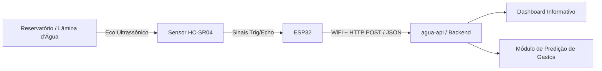

# 💧 HidroSense - Monitoramento Inteligente de Reservatórios

O **HidroSense** é uma solução de sistemas embarcados (IoT) projetada para a medição contínua e automatizada do nível de água em reservatórios e caixas d'água. O sistema coleta dados em tempo real e os transmite para uma API em nuvem (`agua-api`), viabilizando a alimentação de **dashboards informativos** e o desenvolvimento de **modelos preditivos de consumo e gastos**.

---

## 📌 Visão Geral do Sistema

O objetivo principal do HidroSense é transformar a gestão do uso de água em residências, condomínios e indústrias, prevenindo o desabastecimento, identificando anomalias (como vazamentos silenciosos ou consumo atípico) e estimando com antecedência a fatura de água.



---

## ⚙️ Funcionamento do Sistema Embarcado

O firmware (`sketch.ino`), desenvolvido para microcontroladores **ESP32** e projetado para simulação no **Wokwi**, opera segundo o seguinte ciclo:

1. **Aquisição de Dados (Sensoriamento Ultrassônico)**:
   - O microcontrolador envia um pulso de disparo (_trigger_) de 10 µs para o sensor ultrassônico **HC-SR04**.
   - O sensor emite ondas sonoras em direção à superfície da água e recebe o eco refletido.
   - O tempo de retorno do pulso no pino _echo_ é capturado via `pulseIn()`.
   - A distância física da lâmina d'água até o sensor é calculada com base na velocidade do som no ar (~340 m/s):
     $$\text{distância (cm)} = \frac{\text{tempo (}\mu\text{s)} \times 0.034}{2}$$

2. **Processamento e Estruturação**:
   - A leitura é validada e formatada em um payload JSON padronizado:
     ```json
     {
       "distance_cm": 42.5
     }
     ```

3. **Transmissão Segura via Rede (IoT)**:
   - Conecta-se à rede sem fio via biblioteca `WiFi.h`.
   - Realiza uma requisição `HTTP POST` contra o endpoint configurado (`serverName`), enviando cabeçalhos de identificação e autenticação do dispositivo:
     - `device-id`: Identificador exclusivo da caixa d'água/dispositivo (ex: `esp32-caixa-01`).
     - `hash`: Token de autenticação e integridade do nó sensor.

4. **Periodicidade e Eficiência**:
   - O ciclo de leitura e telemetria é repetido a cada intervalo configurado (definido em 10 segundos no ambiente de testes/simulação), otimizando o tráfego de dados e o consumo elétrico.

---

## 📊 Dashboards e Predição de Gastos

Ao receber a distância da lâmina d'água e conhecer as dimensões do reservatório (área da base e altura máxima), o backend é capaz de:

- **Nível e Volume em Tempo Real**: Calcular o volume remanescente em litros e a porcentagem de ocupação do reservatório.
- **Dashboards Informativos**: Exibir gráficos de histórico de nível, vazão média e taxa de reposição/esvaziamento.
- **Predição de Gastos e Tendências**:
  - Algoritmos analíticos projetam a demanda hídrica futura com base no histórico de consumo diário e sazonal.
  - Estimativa do valor da próxima fatura com aplicação das faixas tarifárias da concessionária local.
  - Alertas automáticos para suspeitas de vazamento ou esvaziamento iminente.

---

## 🔌 Hardware e Conexões (Mapeamento de Pinos)

O projeto está mapeado com o microcontrolador **ESP32 DevKit** e o sensor **HC-SR04**:

| Componente  | Pino do Sensor | Pino do ESP32 | Função                        |
| :---------- | :------------- | :------------ | :---------------------------- |
| **HC-SR04** | VCC            | 5V / VIN      | Alimentação (5V)              |
| **HC-SR04** | GND            | GND           | Referência de aterramento     |
| **HC-SR04** | TRIG           | GPIO 5        | Disparo do pulso ultrassônico |
| **HC-SR04** | ECHO           | GPIO 18       | Recepção do tempo de retorno  |

---

## 🚀 Como Executar a Simulação (Wokwi)

1. Abra o projeto no [Wokwi](https://wokwi.com) ou utilize a extensão do Wokwi no VS Code.
2. Certifique-se de que os arquivos `diagram.json` e `sketch.ino` estejam na raiz do projeto.
3. No arquivo `sketch.ino`, configure a URL de destino da API na variável `serverName` (pode ser utilizado um serviço como [webhook.site](https://webhook.site) ou um túnel via Ngrok apontando para a sua API local).
4. Inicie a simulação:
   - O ESP32 conectará na rede simulada `Wokwi-GUEST`.
   - Ajuste o controle deslizante de distância no sensor HC-SR04 para simular variações no nível da água.
   - Acompanhe as leituras e o status de envio no Monitor Serial (115200 baud).
