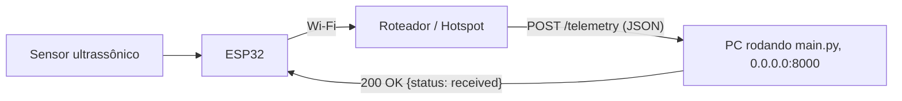

# 💧 HidroSense - Monitoramento Inteligente de Reservatórios

O **HidroSense** é uma solução de sistemas embarcados (IoT) projetada para a medição contínua e automatizada do nível de água em reservatórios e caixas d'água. O sistema coleta dados em tempo real e os transmite para uma API em nuvem (`agua-api`), viabilizando a alimentação de **dashboards informativos** e o desenvolvimento de **modelos preditivos de consumo e gastos**.

---

## 📌 Visão Geral do Sistema

O objetivo principal do HidroSense é transformar a gestão do uso de água em residências, condomínios e indústrias, prevenindo o desabastecimento, identificando anomalias (como vazamentos silenciosos ou consumo atípico) e estimando com antecedência a fatura de água.

```mermaid
flowchart LR
    A[Reservatório / Lâmina d'Água] -->|Eco Ultrassônico| B[Sensor JSN-SR04T]
    B -->|Sinais Trig/Echo (RX/TX)| C[ESP32]
    C -->|WiFi + HTTP POST / JSON| D[agua-api / Backend]
    D --> E[Dashboard Informativo]
    D --> F[Módulo de Predição de Gastos]
```

---

## ⚙️ Funcionamento do Sistema Embarcado

O firmware (`sketch.ino`), desenvolvido para microcontroladores **ESP32** e projetado para simulação no **Wokwi**, opera segundo o seguinte ciclo:

1. **Aquisição de Dados (Sensoriamento Ultrassônico)**:
   - O microcontrolador envia um pulso de disparo (_trigger_) de 20 µs para o sensor ultrassônico à prova d'água **JSN-SR04T**.
   - O transdutor blindado emite ondas sonoras em direção à superfície da água e recebe o eco refletido.
   - O tempo de retorno do pulso no pino _echo_ (TX) é capturado via `pulseIn()`, com timeout de proteção (38 ms, evitando bloqueios).
   - A distância física da lâmina d'água até o sensor é calculada com base na velocidade do som no ar (~343 m/s):
     $$\text{distância (cm)} = \frac{\text{tempo (}\mu\text{s)} \times 0.0343}{2}$$
   - *Zona cega:* O sensor JSN-SR04T possui uma zona morta operacional de ~20 a 25 cm. Recomenda-se fixá-lo a pelo menos 25 cm acima do nível máximo d'água.

2. **Processamento e Estruturação**:
   - A leitura é validada e formatada em um payload JSON padronizado:
     ```json
     {
       "distance_cm": 42.5
     }
     ```

3. **Transmissão Segura via Rede (IoT)**:
   - Conecta-se à rede sem fio via biblioteca `WiFi.h`.
   - Realiza uma requisição `HTTP POST` contra o endpoint configurado (`serverName`), enviando cabeçalhos de identificação e autenticação do dispositivo:
     - `device-id`: Identificador exclusivo da caixa d'água/dispositivo (ex: `esp32-caixa-01`).
     - `hash`: Token de autenticação e integridade do nó sensor.

4. **Periodicidade e Eficiência**:
   - O ciclo de leitura e telemetria é repetido a cada intervalo configurado (definido em 10 segundos no ambiente de testes/simulação), otimizando o tráfego de dados e o consumo elétrico.

---

## 📊 Dashboards e Predição de Gastos

Ao receber a distância da lâmina d'água e conhecer as dimensões do reservatório (área da base e altura máxima), o backend é capaz de:

- **Nível e Volume em Tempo Real**: Calcular o volume remanescente em litros e a porcentagem de ocupação do reservatório.
- **Dashboards Informativos**: Exibir gráficos de histórico de nível, vazão média e taxa de reposição/esvaziamento.
- **Predição de Gastos e Tendências**:
  - Algoritmos analíticos projetam a demanda hídrica futura com base no histórico de consumo diário e sazonal.
  - Estimativa do valor da próxima fatura com aplicação das faixas tarifárias da concessionária local.
  - Alertas automáticos para suspeitas de vazamento ou esvaziamento iminente.

---

## 🔌 Hardware e Conexões (Mapeamento de Pinos)

O projeto está mapeado para o microcontrolador **ESP32 DevKit** e o sensor ultrassônico **JSN-SR04T** (versão com transdutor blindado e à prova d'água IP67):

| Componente    | Pino do Sensor (JSN-SR04T) | Pino do ESP32 | Função                                            |
| :------------ | :------------------------- | :------------ | :------------------------------------------------ |
| **JSN-SR04T** | 5V / VCC                   | 5V / VIN      | Alimentação (5V / VIN ou 3.3V no JSN-SR04T V3.x)  |
| **JSN-SR04T** | GND                        | GND           | Referência de aterramento                         |
| **JSN-SR04T** | TRIG / RX                  | GPIO 5        | Disparo do pulso ultrassônico (Trigger)           |
| **JSN-SR04T** | ECHO / TX                  | GPIO 18       | Recepção do tempo de retorno (Echo com pull-up)   |

> **Observações de Hardware:**
> - **Sinal e Níveis Lógicos:** No módulo JSN-SR04T, os pinos de pulso geralmente são identificados como **TRIG (ou RX)** e **ECHO (ou TX)**. O pino ECHO/TX é conectado ao **GPIO 18**, configurado como `INPUT_PULLUP` no ESP32 para estabilizar a leitura em 3.3V.
> - **Resistência à Umidade:** Diferente do HC-SR04 comum, o JSN-SR04T possui transdutor vedado IP67 em cápsula metálica com cabo de extensão, sendo apropriado para ambientes com vapor e condensação típicos de reservatórios de água.
> - **Zona Cega (Blind Spot):** O sensor requer uma distância mínima de 20 a 25 cm entre o transdutor e a superfície da água para leitura precisa.

---

## 🚀 Como Executar a Simulação (Wokwi)

1. Abra o projeto no [Wokwi](https://wokwi.com) ou utilize a extensão do Wokwi no VS Code.
2. Certifique-se de que os arquivos `diagram.json` e `sketch.ino` estejam na raiz do projeto.
   > *Nota sobre a simulação:* Como o simulador Wokwi não possui um modelo gráfico dedicado para o JSN-SR04T, o componente `wokwi-hc-sr04` é utilizado no diagrama com os mesmos pinos (GPIO 5 e GPIO 18), uma vez que ambos os sensores compartilham o protocolo de disparo por Trigger/Echo.
3. No arquivo `sketch.ino`, configure a URL de destino da API na variável `serverName` (pode ser utilizado um serviço como [webhook.site](https://webhook.site) ou um túnel via Ngrok apontando para a sua API local).
4. Inicie a simulação:
   - O ESP32 conectará na rede simulada `Wokwi-GUEST`.
   - Ajuste o controle deslizante de distância no sensor ultrassônico para simular variações no nível da água.
   - Acompanhe as leituras e o status de envio no Monitor Serial (115200 baud).

---

# agua-api mock (ESP32 → Python)

Servidor local em **FastAPI** que se passa pela `agua-api`. Ele recebe a telemetria do sensor de nível que o **ESP32** envia e imprime tudo no terminal. Serve para testar o firmware sem depender do backend real.

---

## 1. Visão geral



O ESP32 e o PC se conectam **ao mesmo roteador**. O roteador dá a cada aparelho um IP privado (ex.: `192.168.0.10` e `192.168.0.25`). Como os dois estão na mesma sub-rede, o ESP32 chega ao PC direto pelo IP dele, sem passar pela internet.

O servidor escuta em `0.0.0.0`, ou seja, em **todas as interfaces de rede** do PC. Por isso ele aceita conexões vindas da rede local e não só do `localhost`.

---

## 2. Contrato da API

| Item | Valor |
|---|---|
| Método | `POST` |
| Rotas | `/telemetry` ou `/` |
| Porta | `8000` |
| Header `Content-Type` | `application/json` |
| Header `device-id` | `esp32-caixa-01` |
| Header `hash` | `hash-legal` |
| Body | `{"distance_cm": <float>}` |

**Respostas:**

| Código | Quando | Body |
|---|---|---|
| `200` | Payload válido | `{"status": "received", "distance_cm": 42.7, "timestamp": "..."}` |
| `400` | JSON inválido ou sem `distance_cm` | `{"status": "error", "detail": "..."}` |

> Os headers `device-id` e `hash` **não bloqueiam** a requisição. O servidor só mostra no log se eles batem com o esperado (`OK` / `DIFERENTE DO ESPERADO`).

Também existe um `GET /` de health check, útil para testar pelo navegador.

---

## 3. Instalação

Pré-requisito: Python 3.9+.

**macOS / Linux**
```bash
python3 -m venv .venv
source .venv/bin/activate
pip install -r requirements.txt
```

**Windows (PowerShell)**
```powershell
python -m venv .venv
.venv\Scripts\Activate.ps1
pip install -r requirements.txt
```

---

## 4. Rodando o servidor

```bash
python main.py
```

Ao subir, o servidor mostra o IP local que foi detectado e a URL pronta para colar no firmware:

```
>> agua-api mock rodando em http://192.168.0.25:8000/telemetry
>> Use no firmware: serverName = "http://192.168.0.25:8000/telemetry"

INFO:     Uvicorn running on http://0.0.0.0:8000 (Press CTRL+C to quit)
```

Para parar, use `Ctrl+C`.

---

## 5. Descobrindo o IP do PC

O IP impresso na inicialização normalmente já é o certo. Se o PC tiver mais de uma interface (VPN, cabo + Wi-Fi), confira manualmente:

| SO | Comando | Onde olhar |
|---|---|---|
| macOS | `ipconfig getifaddr en0` | Saída direta (Wi-Fi) |
| Linux | `hostname -I` ou `ip addr show` | Interface `wlan0` / `wlp*` |
| Windows | `ipconfig` | "Endereço IPv4" do adaptador Wi-Fi |

Use o IP da interface que está **na mesma rede do ESP32**. Normalmente ele começa com `192.168.`, `10.` ou `172.16–31.`.

---

## 6. Configurando o ESP32

Exemplo mínimo em Arduino (core ESP32), usando `WiFi.h` e `HTTPClient.h`:

```cpp
#include <WiFi.h>
#include <HTTPClient.h>

const char* ssid       = "NOME_DA_REDE";
const char* password   = "SENHA_DA_REDE";
const char* serverName = "http://192.168.0.25:8000/telemetry"; // IP do PC

void setup() {
  Serial.begin(115200);
  WiFi.begin(ssid, password);
  while (WiFi.status() != WL_CONNECTED) {
    delay(500);
    Serial.print(".");
  }
  Serial.print("\nConectado! IP do ESP32: ");
  Serial.println(WiFi.localIP());
}

void loop() {
  if (WiFi.status() == WL_CONNECTED) {
    float distance_cm = 42.7; // substitua pela leitura do sensor

    HTTPClient http;
    http.begin(serverName);
    http.addHeader("Content-Type", "application/json");
    http.addHeader("device-id", "esp32-caixa-01");
    http.addHeader("hash", "hash-legal");

    String body = "{\"distance_cm\": " + String(distance_cm, 2) + "}";
    int code = http.POST(body);

    Serial.printf("HTTP %d -> %s\n", code, http.getString().c_str());
    http.end();
  }
  delay(5000);
}
```

**Checklist:**
1. `ssid`/`password` são da **mesma rede** em que o PC está.
2. `serverName` usa `http://` (não `https://`), o IP do PC e a porta `8000`.
3. O IP do ESP32 mostrado no Serial Monitor está na mesma faixa do IP do PC (ex.: os dois em `192.168.0.x`).

---

## 7. Testando sem o ESP32

Com o servidor rodando, simule o envio do ESP32:

```bash
curl -X POST http://localhost:8000/telemetry \
  -H "Content-Type: application/json" \
  -H "device-id: esp32-caixa-01" \
  -H "hash: hash-legal" \
  -d '{"distance_cm": 42.7}'
```

Para testar **pela rede**, rode o mesmo comando em outro aparelho trocando `localhost` pelo IP do PC. Também dá para abrir `http://<IP_DO_PC>:8000/` no navegador do celular. Se aparecer `{"status":"ok"}`, o ESP32 também vai conseguir conectar.

Saída esperada no terminal do servidor:

```
============================================================
[2026-10-31 21:37:33.446] POST /telemetry  de 192.168.0.40
  Content-Type : application/json
  device-id    : 'esp32-caixa-01'  (OK)
  hash         : 'hash-legal'  (OK)
  payload bruto: {"distance_cm": 42.7}
  distance_cm  : 42.70 cm
============================================================
```

O campo `de ...` mostra o IP de quem enviou, que no caso real é o IP do ESP32.

---

## 8. Solução de problemas

| Sintoma no ESP32 | Causa provável | Solução |
|---|---|---|
| `HTTP -1` (connection refused) | Servidor parado ou porta errada | Confirme que `python main.py` está rodando e que a porta é `8000` |
| `HTTP -1` / timeout | Firewall do PC bloqueando | Veja a seção abaixo |
| `HTTP -1` mesmo com firewall liberado | Rede com **isolamento de clientes** (comum em redes de faculdade/empresa e redes "convidado") | Use o **hotspot do celular** para o PC e o ESP32 |
| `HTTP 400` | JSON mal formado ou sem `distance_cm` | Confira o body e o log do servidor |
| `HTTP 404` | Rota errada | Use `/telemetry` ou `/` |
| Funciona com `localhost` mas não pelo IP | IP errado (VPN, outra interface) | Refaça a seção 5 e desligue a VPN |
| O IP do PC mudou | DHCP deu outro endereço | Atualize o `serverName` ou fixe o IP no roteador |

### Liberando o firewall

- **macOS:** na primeira execução, clique em **Permitir** no aviso "aceitar conexões de entrada". Se clicou em negar: *Ajustes do Sistema → Rede → Firewall → Opções* e libere o `python`.
- **Windows:** clique em **Permitir acesso** no alerta do Defender (marque *Redes privadas*). Ou, como administrador:
  ```powershell
  netsh advfirewall firewall add rule name="agua-api mock" dir=in action=allow protocol=TCP localport=8000
  ```
- **Linux (ufw):**
  ```bash
  sudo ufw allow 8000/tcp
  ```

---

## 9. Estrutura

```
.
├── main.py           # servidor FastAPI (mock da agua-api)
├── requirements.txt  # fastapi + uvicorn
└── README.md
```
